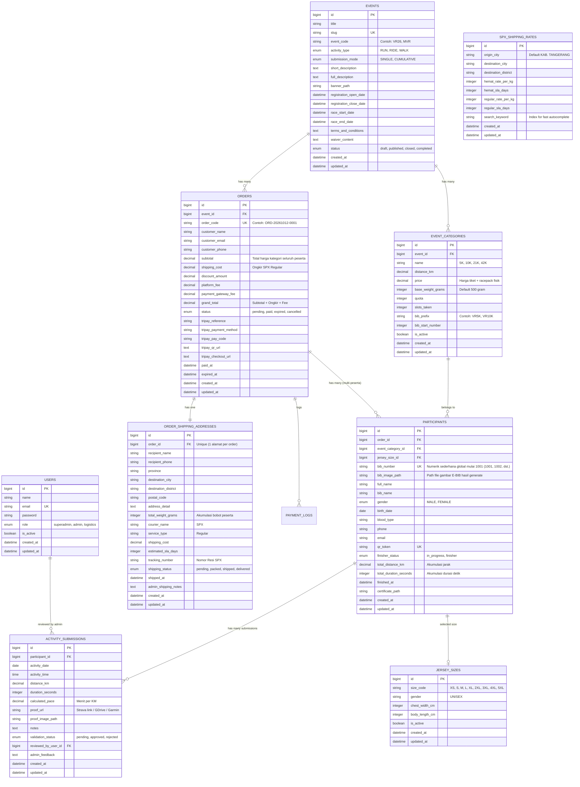

# Skema Database — Virtual Run Platform
**Proyek:** Platform Event Lari Virtual (Transisi dari Jelatix)  
**Tipe Engine:** Relational Database (SQLite / MySQL Compatible)  
**Origin Pengiriman:** KAB. TANGERANG (SPX Express)  
**Versi:** 2.0  
**Tanggal:** 12 Oktober 2026  

---

## 1. Entity Relationship Diagram (ERD)



---

## 2. Rincian Tabel & Struktur Kolom (Laravel Migration Specification)

### 2.1 Tabel `spx_shipping_rates` (Master Ongkir SPX)
Menyimpan tarif resmi SPX dari titik origin **KAB. TANGERANG** ke 7.100 kecamatan se-Indonesia.
```php
Schema::create('spx_shipping_rates', function (Blueprint $table) {
    $table->id();
    $table->string('origin_city', 100)->default('KAB. TANGERANG');
    $table->string('destination_city', 150);
    $table->string('destination_district', 150);
    $table->unsignedInteger('hemat_rate_per_kg')->default(0);
    $table->unsignedSmallInteger('hemat_sla_days')->default(0);
    $table->unsignedInteger('regular_rate_per_kg')->default(0);
    $table->unsignedSmallInteger('regular_sla_days')->default(0);
    $table->string('search_keyword')->index(); // Format lowercase: "kuta kab. badung"
    $table->timestamps();

    $table->unique(['destination_city', 'destination_district']);
    $table->index('destination_city');
    $table->index('destination_district');
});
```

---

### 2.2 Tabel `events` (Virtual Run Events)
```php
Schema::create('events', function (Blueprint $table) {
    $table->id();
    $table->string('title');
    $table->string('slug')->unique();
    $table->string('event_code', 10)->unique(); // Kode event untuk prefix e-BIB (misal: VR26, MVR)
    $table->enum('activity_type', ['RUN', 'RIDE', 'WALK'])->default('RUN');
    $table->enum('submission_mode', ['SINGLE', 'CUMULATIVE'])->default('CUMULATIVE');
    $table->text('short_description')->nullable();
    $table->longText('full_description')->nullable();
    $table->string('banner_path')->nullable();
    $table->dateTime('registration_open_date');
    $table->dateTime('registration_close_date');
    $table->dateTime('race_start_date');
    $table->dateTime('race_end_date');
    $table->longText('terms_and_conditions')->nullable();
    $table->longText('waiver_content')->nullable();
    $table->enum('status', ['draft', 'published', 'closed', 'completed'])->default('draft');
    $table->timestamps();

    $table->index(['status', 'race_start_date']);
});
```

---

### 2.3 Tabel `event_categories` (Kategori Jarak & Racepack)
```php
Schema::create('event_categories', function (Blueprint $table) {
    $table->id();
    $table->foreignId('event_id')->constrained('events')->cascadeOnDelete();
    $table->string('name'); // Contoh: "5K Fun Virtual", "10K Challenge", "21K Half Marathon"
    $table->decimal('distance_km', 8, 2); // Target kilometer
    $table->decimal('price', 12, 2); // Harga pendaftaran (termasuk race pack fisik)
    $table->unsignedInteger('base_weight_grams')->default(500); // Berat race pack per orang (gram)
    $table->unsignedInteger('quota')->default(100);
    $table->unsignedInteger('slots_taken')->default(0);
    $table->boolean('is_active')->default(true);
    $table->timestamps();
});
```

---

### 2.4 Tabel `orders` (Transaksi Pemesanan)
```php
Schema::create('orders', function (Blueprint $table) {
    $table->id();
    $table->foreignId('event_id')->constrained('events')->cascadeOnDelete();
    $table->string('order_code', 50)->unique(); // Contoh: ORD-20261012-0001
    $table->string('customer_name');
    $table->string('customer_email');
    $table->string('customer_phone');
    $table->decimal('subtotal', 12, 2)->default(0); // Total tiket peserta
    $table->decimal('shipping_cost', 12, 2)->default(0); // Ongkir SPX Regular
    $table->decimal('discount_amount', 12, 2)->default(0);
    $table->decimal('platform_fee', 12, 2)->default(0);
    $table->decimal('payment_gateway_fee', 12, 2)->default(0);
    $table->decimal('grand_total', 12, 2)->default(0); // Subtotal + Shipping + Fee
    $table->enum('status', ['pending', 'paid', 'expired', 'cancelled'])->default('pending');
    $table->string('tripay_reference')->nullable()->index();
    $table->string('tripay_payment_method')->nullable();
    $table->string('tripay_pay_code')->nullable();
    $table->text('tripay_qr_url')->nullable();
    $table->text('tripay_checkout_url')->nullable();
    $table->dateTime('paid_at')->nullable();
    $table->dateTime('expired_at')->nullable();
    $table->timestamps();

    $table->index(['status', 'created_at']);
});
```

---

### 2.5 Tabel `order_shipping_addresses` (Alamat & Resi SPX)
Menyimpan alamat tujuan gabungan untuk 1 pesanan, berat total akumulatif, biaya ongkir, dan nomor resi pengiriman SPX.
```php
Schema::create('order_shipping_addresses', function (Blueprint $table) {
    $table->id();
    $table->foreignId('order_id')->unique()->constrained('orders')->cascadeOnDelete();
    $table->string('recipient_name');
    $table->string('recipient_phone', 30);
    $table->string('province', 100);
    $table->string('destination_city', 150);
    $table->string('destination_district', 150);
    $table->string('postal_code', 10)->nullable();
    $table->text('address_detail');
    $table->unsignedInteger('total_weight_grams'); // Total berat seluruh peserta
    $table->string('courier_name', 50)->default('SPX');
    $table->string('service_type', 50)->default('Regular');
    $table->decimal('shipping_cost', 12, 2);
    $table->unsignedSmallInteger('estimated_sla_days')->default(0);
    $table->string('tracking_number', 100)->nullable()->index(); // Nomor Resi SPX
    $table->enum('shipping_status', ['pending', 'packed', 'shipped', 'delivered'])->default('pending');
    $table->dateTime('shipped_at')->nullable();
    $table->text('admin_shipping_notes')->nullable();
    $table->timestamps();

    $table->index(['shipping_status', 'created_at']);
});
```

---

### 2.6 Tabel `participants` (Data Peserta Multi-Registrasi)
Setiap peserta terhubung ke `order_id` dan memiliki e-BIB serta pencatatan jarak virtual masing-masing.
```php
Schema::create('participants', function (Blueprint $table) {
    $table->id();
    $table->foreignId('order_id')->constrained('orders')->cascadeOnDelete();
    $table->foreignId('event_category_id')->constrained('event_categories')->cascadeOnDelete();
    $table->foreignId('jersey_size_id')->nullable()->constrained('jersey_sizes')->nullOnDelete();
    $table->string('bib_number', 50)->nullable()->unique(); // Numerik sederhana mulai dari 1001, bertambah global lintas event (1001, 1002, dst.)
    $table->string('bib_image_path')->nullable(); // File gambar kartu E-BIB yang di-generate otomatis
    $table->string('full_name');
    $table->string('bib_name', 50)->nullable();
    $table->enum('gender', ['MALE', 'FEMALE']);
    $table->date('birth_date');
    $table->string('blood_type', 10)->default('Unknown');
    $table->string('phone', 30);
    $table->string('email');
    $table->string('qr_token', 64)->unique();
    $table->enum('finisher_status', ['in_progress', 'finisher'])->default('in_progress');
    $table->decimal('total_distance_km', 8, 2)->default(0.00);
    $table->unsignedInteger('total_duration_seconds')->default(0);
    $table->dateTime('finished_at')->nullable();
    $table->string('certificate_path')->nullable();
    $table->timestamps();

    $table->index('bib_number');
    $table->index(['event_category_id', 'finisher_status']);
});
```

---

### 2.7 Tabel `activity_submissions` (Catatan Lari & Verifikasi)
```php
Schema::create('activity_submissions', function (Blueprint $table) {
    $table->id();
    $table->foreignId('participant_id')->constrained('participants')->cascadeOnDelete();
    $table->date('activity_date');
    $table->time('activity_time')->nullable();
    $table->decimal('distance_km', 8, 2);
    $table->unsignedInteger('duration_seconds');
    $table->decimal('calculated_pace', 6, 2)->nullable(); // Menit per KM
    $table->string('proof_url')->nullable(); // Strava / Garmin / GDrive Link
    $table->string('proof_image_path')->nullable(); // Upload screenshot
    $table->text('notes')->nullable();
    $table->enum('validation_status', ['pending', 'approved', 'rejected'])->default('pending');
    $table->foreignId('reviewed_by_user_id')->nullable()->constrained('users')->nullOnDelete();
    $table->text('admin_feedback')->nullable();
    $table->timestamps();

    $table->index(['participant_id', 'validation_status']);
});
```

---

### 2.8 Tabel Master `jersey_sizes` (Ukuran Jersey Fisik)
```php
Schema::create('jersey_sizes', function (Blueprint $table) {
    $table->id();
    $table->string('size_code', 10)->unique(); // XS, S, M, L, XL, 2XL, 3XL, 4XL, 5XL
    $table->string('gender', 20)->default('UNISEX');
    $table->unsignedSmallInteger('chest_width_cm')->nullable();
    $table->unsignedSmallInteger('body_length_cm')->nullable();
    $table->boolean('is_active')->default(true);
    $table->timestamps();
});
```

---

## 3. Komponen yang Dihapus / Dinonaktifkan dari Versi Lama

1. **Modul Pengambilan Racepack Venue (RPC Scanner):**
   - Hapus tabel / kolom: `is_rpc_claimed`, `rpc_claimed_at`, `rpc_claimed_by_user_id`, `is_proxy_claimed`, `proxy_collector_name`, `proxy_document_path`.
   - Hapus route `/crew` dan `CrewScannerController`.
2. **Modul Multi-Organizer & Komisi:**
   - Tabel `organizers` dan `organizer_payouts` dinonaktifkan / digabungkan ke manajemen platform internal.
   - Kolom `organizer_id` pada `events` tidak lagi diperlukan untuk flow publik (diatur langsung oleh superadmin internal).
